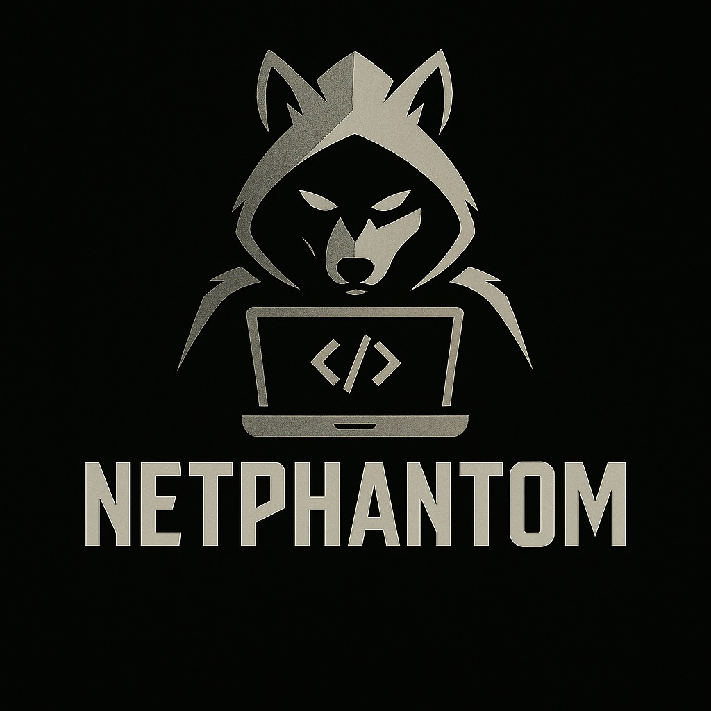

<p align="center">
  
</p>

<h1 align="center">SiBlog</h1>

<p align="center">
  <strong>Platform Blog & Publikasi Konten Editorial Modern Berbasis Laravel 12</strong>
</p>

<p align="center">
  
  
  
  
  
  
  
</p>

---

## Tentang SiBlog

**SiBlog** adalah platform publikasi blog editorial yang dirancang dengan estetika minimalis, tipografi bernilai tinggi (*editorial design taste*), dan fokus pada kenyamanan membaca (*reading ergonomics*). 

Dibangun di atas **Laravel 12**, SiBlog menyajikan perpaduan antara performa backend yang solid, arsitektur Blade yang bersih, dan sistem desain modern menggunakan tipografi **Instrument Serif** dipadukan dengan **DM Sans**.

---

## Fitur Utama

### Antarmuka Publik
- **Tipografi & Estetika Editorial**: Tampilan bersih dengan hierarki visual terarah, bebas dari elemen klise (*anti-slop*), berstandar kontras WCAG AA.
- **Featured Lead Card**: Artikel pertama pada beranda otomatis ditampilkan sebagai kartu sorotan (*lead article*) dengan ringkasan yang proporsional.
- **Placeholder Duotone Elegan**: Monogram editorial berseni bagi artikel yang belum memiliki unggahan gambar sampul.
- **Pencarian Artikel Instan**: Filter pencarian judul dan isi artikel dengan penanganan *empty state* yang informatif.
- **Ergonomi Membaca**: Teks isi artikel berukuran 18px (bobot reguler 400, line-height 1.85) dilengkapi *drop cap* paragraf pertama yang presisi.
- **Kotak Berbagi Responsif**: Salin tautan satu-klik dengan notifikasi tersalin, serta tombol berbagi langsung ke WhatsApp dan X (Twitter).
- **Smooth Scroll**: Tombol pill *"Kembali ke Atas"* pada footer.

### Admin Panel & Manajemen Konten (CRUD)
- **Dashboard Kelola Artikel**: Tabel artikel yang otomatis bertransformasi menjadi **kartu susun vertikal (*stacked touch cards*)** pada perangkat mobile (`< 768px`) tanpa *horizontal scrolling*.
- **Pembuatan & Pengeditan Artikel**:
  - Live auto-slug generator berbasis judul secara real-time.
  - Penghitung kata (*real-time word counter*).
  - Zona unggah gambar drag-and-drop dengan validasi ukuran (maks. 2MB) dan *live image preview*.
- **Manajemen Profil**: Pengaturan data akun administrator, pembaruan kata sandi, dan proteksi hapus akun dengan modal konfirmasi.
- **Keamanan Ketat**: Proteksi CSRF, sanitasi input Blade, autentikasi terisolasi, dan penonaktifan registrasi publik terbuka.

### CI/CD & Infrastruktur
- **100% Automated Test Coverage**: 34 unit & feature tests mencakup otentikasi, CRUD, otorisasi, pencarian, dan profil.
- **Docker & Podman Ready**: Konfigurasi multi-container siap pakai (PHP 8.2-FPM, Nginx, MySQL 8.0).
- **GitHub Actions Pipeline**: CI otomatis (pengujian unit & build asset) serta CD otomatis via SSH ke server target.

---

## Tech Stack

| Komponen | Teknologi |
|---|---|
| **Backend Framework** | [Laravel 12](https://laravel.com) |
| **Bahasa Pemrograman** | [PHP 8.2+](https://php.net) |
| **Database** | MySQL 8.0 (Produksi) / SQLite In-Memory (Pengujian) |
| **Frontend & Styling** | Laravel Blade, [Tailwind CSS](https://tailwindcss.com), Alpine.js |
| **Asset Bundler** | [Vite 7](https://vitejs.dev) |
| **Tipografi** | *Instrument Serif* (Display/Heading) & *DM Sans* (Body/UI) |
| **Containerization** | Docker, Docker Compose, Podman |
| **CI/CD** | GitHub Actions (`.github/workflows/deploy.yml`) |

---

## Panduan Instalasi & Menjalankan Lokal

Pastikan Anda telah memasang **Git**, serta **Docker/Podman** ATAU **PHP 8.2 + Composer + Node.js 20+**.

### 1. Clone Repository
```bash
git clone https://github.com/username/siblog-project.git
cd siblog-project
```

### 2. Jalankan Aplikasi

#### Pilihan A: Menggunakan Docker / Podman Compose (Rekomendasi)
```bash
# Salin konfigurasi environment
cp .env.example .env

# Jalankan container (PHP-FPM, Nginx, MySQL)
docker compose up -d --build
# atau jika menggunakan Podman:
podman-compose up -d

# Jalankan setup database di dalam container
docker compose exec app php artisan key:generate
docker compose exec app php artisan migrate --seed
docker compose exec app php artisan storage:link
```
Aplikasi dapat langsung diakses melalui browser di **`http://localhost:8000`**.

---

#### Pilihan B: Menggunakan PHP Lokal (Native)
```bash
# 1. Salin file konfigurasi environment
cp .env.example .env

# 2. Pasang dependensi PHP & Node.js
composer install
npm install

# 3. Generate Application Key & Storage Link
php artisan key:generate
php artisan storage:link

# 4. Konfigurasi database di file .env, lalu jalankan migrasi & seeder
php artisan migrate --seed

# 5. Kompilasi asset frontend
npm run build

# 6. Jalankan server lokal
php artisan serve
```
Aplikasi akan aktif di **`http://127.0.0.1:8000`**.

---

## Kredensial Akun Default

Setelah menjalankan perintah `php artisan db:seed`, akun administrator berikut siap digunakan:

- **Halaman Masuk**: `http://localhost:8000/login`
- **Username**: `dapit`
- **Email**: `dapit@gmail.com`
- **Password**: `password`

---

## Menjalankan Automated Tests

Aplikasi dilengkapi test suite komprehensif (34 feature & unit tests). Untuk menjalankannya:

```bash
php artisan test
```

Contoh output:
```text
   PASS  Tests\Unit\ExampleTest
   PASS  Tests\Feature\AdminArticleTest
   PASS  Tests\Feature\Auth\AuthenticationTest
   PASS  Tests\Feature\Auth\EmailVerificationTest
   PASS  Tests\Feature\Auth\PasswordConfirmationTest
   PASS  Tests\Feature\Auth\PasswordResetTest
   PASS  Tests\Feature\Auth\PasswordUpdateTest
   PASS  Tests\Feature\Auth\RegistrationTest
   PASS  Tests\Feature\ExampleTest
   PASS  Tests\Feature\ProfileTest
   PASS  Tests\Feature\PublicArticleTest

  Tests:    34 passed (92 assertions)
  Duration: 1.64s
```

---

## Otomasi CI/CD (GitHub Actions)

Project ini dilengkapi workflow CI/CD di `.github/workflows/deploy.yml`:

1. **Continuous Integration (CI)**:
   - Dijalankan setiap ada `push` atau `pull_request` ke branch `main` atau `master`.
   - Menyiapkan environment PHP 8.2 dan Node.js 20.
   - Mengompilasi asset frontend dengan Vite (`npm run build`).
   - Menjalankan seluruh pengujian unit/fitur (`php artisan test`).
2. **Continuous Deployment (CD)**:
   - Jika pengujian lulus dan branch adalah `main`/`master`, alur CD akan menghubungi server VPS via SSH.
   - Menarik kode terbaru, menjalankan build/restart container, migrasi database, dan pembersihan cache produksi secara otomatis.

### Konfigurasi GitHub Secrets yang Dibutuhkan:
Tambahkan nilai-nilai berikut di menu **Settings → Secrets and variables → Actions** repository GitHub Anda:
- `SERVER_HOST`: IP atau domain server produksi.
- `SERVER_USERNAME`: Username SSH di server (contoh: `ubuntu` atau `root`).
- `SERVER_SSH_KEY`: Private SSH Key komputer/server deployment.
- `SERVER_PORT`: Port SSH (default: `22`).
- `SERVER_PROJECT_PATH`: Lokasi path absolut project di server (contoh: `/var/www/siblog-project`).

---

## Struktur Direktori Utama

```text
siblog-project/
├── .github/workflows/       # Workflow CI/CD GitHub Actions
│   └── deploy.yml
├── app/
│   ├── Http/Controllers/    # ArticleController, PublicArticleController, ProfileController
│   └── Models/              # Article, User
├── database/
│   ├── migrations/          # Skema database
│   └── seeders/             # DatabaseSeeder & data awal
├── docker/                  # Konfigurasi Nginx untuk container
├── public/
│   ├── build/               # Asset Vite hasil kompilasi
│   └── images/              # Logo resmi aplikasi (Logo.jpg)
├── resources/
│   ├── css/                 # Styling Tailwind
│   ├── js/                  # Inisialisasi JS & Alpine.js
│   └── views/               # Blade Templates
│       ├── admin/articles/  # Dashboard, form create & edit
│       ├── articles/        # Halaman show detail artikel
│       ├── auth/            # Halaman login
│       ├── layouts/         # Layout public, app (admin), dan guest
│       └── profile/         # Pengaturan profil & akun
├── routes/                  # web.php & auth.php
├── tests/                   # Feature & Unit test suite
├── Dockerfile               # Konfigurasi image PHP 8.2
├── docker-compose.yml       # Orkestrasi container App, Web, & DB
└── deploy.sh                # Skrip deployment manual server
```

---

## Lisensi

Project ini dirilis di bawah lisensi terbuka [MIT License](LICENSE).
